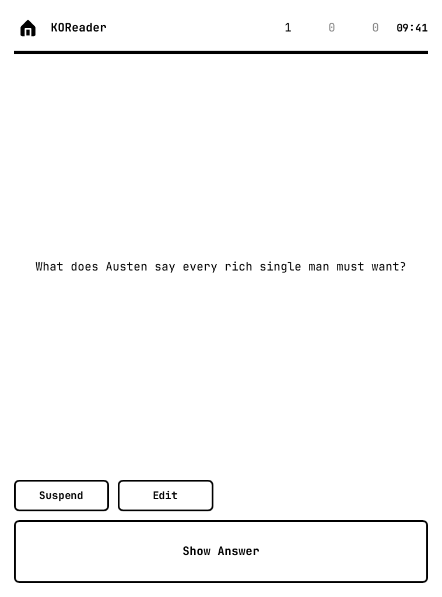

# pbAnki

**Anki flashcards on PocketBook e-readers, designed for e-ink, with cards you make while reading in KOReader.**

This is a fork of [ananyatimalsina/pbanki](https://github.com/ananyatimalsina/pbanki), which got Anki's real scheduler running on PocketBook. This fork rebuilds the reading and studying experience around the e-ink screen, adds a way to turn book highlights into cards, and puts the codebase on a tested, documented footing.

Developed and tested on a **PocketBook Verse (PB629)**, firmware 6.11. Every screenshot below is rendered at that screen's exact resolution (758 × 1024, 16 shades of grey) by the emulator included in this repo, and the KOReader ones by KOReader itself running headless.

<table>
  <tr>
    <th>Before</th>
    <th>This fork</th>
  </tr>
  <tr>
    <td></td>
    <td></td>
  </tr>
</table>

## What's different in this fork

### Text made for a 6-inch e-ink screen

The original UI ran at three times the intended size on the device, so about four short lines fit on a card and long cards were split across mostly empty pages. Text is now set in [JetBrains Mono](https://www.jetbrains.com/lp/mono/) at 20 px (adjustable from 12 to 40 px in Settings). Because every character has the same width, pbAnki works out exactly how much text fits, and pages are full: 59 × 24 characters at the default size.

<table>
  <tr>
    <th>Before</th>
    <th>This fork</th>
  </tr>
  <tr>
    <td></td>
    <td></td>
  </tr>
  <tr>
    <td></td>
    <td></td>
  </tr>
</table>

### Cards that look like Anki cards

The original stripped every card down to plain text, so the question and answer ran together ("What is the capital of France? Paris") and line breaks disappeared ("novelPride and Prejudice"). pbAnki now lays out the card's HTML: bold, italic, line breaks, paragraphs, lists, and the divider between front and back. Cloze deletions highlight the active blank. Cards are centred vertically, and the answer opens on the page where the back begins.

<table>
  <tr>
    <td></td>
    <td></td>
    <td></td>
  </tr>
</table>

### Make cards while you read, in KOReader

Highlight a passage in [KOReader](https://koreader.rocks) and tap **Create flashcard**. The passage is saved as a normal highlight and a card editor opens. Or keep reading and highlighting, then pick **Flashcards from highlights** in the Tools menu to turn the new highlights into cards one after another, skipping the ones you don't want. Each highlight is offered once; the plugin remembers which ones you've reviewed in the book's own KOReader settings.

With the [AI Assistant](https://github.com/omer-faruq/assistant.koplugin) plugin installed, the editor opens with suggested cards: short questions with short answers, each asking something different about the highlight. While reading, you choose how many cards to ask for (1 by default). In batch mode the AI decides: one card for a focused highlight, more for a rich one, up to a limit you set. The AI sees the book, chapter, the text around the highlight and your note on it. Edit them, drop them, or tap **Suggest more** to add more below them (up to 10 at a time) and keep the ones you like; long lists split into pages. Suggest more learns from what you did: it writes in the style of the cards you kept, follows the way you rewrote any of its cards, and avoids cards like the ones you removed. AI suggestions can be turned off, for example in flight mode: you then write the card yourself, the front on one full screen and the back on the next.

<table>
  <tr>
    <td></td>
    <td></td>
    <td></td>
  </tr>
</table>

Cards wait in an inbox file until pbAnki next opens, then land in a sub-deck per book under **KOReader**, such as `KOReader::Pride and Prejudice`. Study the KOReader deck to review every book at once, or open one book's deck. Each card keeps its **context**: the full highlighted passage, book, author, chapter and page. A **Context** button on the answer side shows it.

<table>
  <tr>
    <td></td>
    <td></td>
    <td></td>
    <td></td>
  </tr>
</table>

### A deck list you can read at a glance

Counts are labelled, due cards are bold, zeros are grey, and every row is a full-width tap target. Collapsing a deck hides all of its sub-decks and is saved in the collection, as in desktop Anki.

<table>
  <tr>
    <th>Before</th>
    <th>This fork</th>
  </tr>
  <tr>
    <td></td>
    <td></td>
  </tr>
</table>

### Settings on the device

Text size has a live preview. The AnkiWeb login is typed with the PocketBook's own keyboard and must pass **Validate** (a real login to AnkiWeb) before it can be saved; a wrong password is caught on the spot instead of at the first sync.

<table>
  <tr>
    <td></td>
    <td></td>
    <td></td>
  </tr>
</table>

### Sync with AnkiWeb

Tap **Sync** on the deck list, or turn on **Sync on startup** in Settings. Wi-Fi is turned on if it's off, and a status bar shows each step: turning on Wi-Fi, logging in, syncing, then the result. Cards made in KOReader are imported first, so they go up in the same sync. The deck list can't be opened while a sync runs.

When AnkiWeb can't merge the two collections (after a reset on another device, for example), pbAnki asks which one to keep and confirms before replacing anything. Before AnkiWeb's collection replaces this one, the reader's collection is saved to `collection/backups/before-download-<time>.colpkg`, which desktop Anki can import. Media files aren't synced.

<table>
  <tr>
    <td></td>
    <td></td>
    <td></td>
  </tr>
</table>

### Studying

- Tap anywhere on the question to reveal the answer, and tap the answer to rate it **Good**. On an answer longer than one page, a tap turns the page first.
- Rated too fast? Swipe from right to left, or press the **prev** button, to undo the last rating or suspension and see that card's answer again.
- The **next** button does the same as a tap: next page, reveal, then Good. **Prev** goes back a page, or undoes on a card's first page.
- Swipe up and down to turn pages. Again, Hard and Easy are on the on-screen buttons.
- **Suspend** removes an unwanted card from review, as in desktop Anki. Undo brings it back.
- **Edit** fixes a card while you study it: the front on one full screen, then the back on the next. Tap the text to change it with the PocketBook keyboard, then **Save**. The card keeps its place and its schedule. Text is edited as plain text with line breaks; a side with formatting (bold, images) says so, and loses it only if you change that side.
- Buttons are outlined and invert while pressed, which reads clearly on e-ink.
- When a deck is done, a "Congratulations!" screen appears with a way back to the deck list.
- Type-in cards are skipped (buried until tomorrow), since typing on e-ink is no fun.
- If the collection can't be opened, pbAnki says why instead of quitting.

<table>
  <tr>
    <td></td>
    <td></td>
    <td></td>
  </tr>
</table>

### Under the hood

- **One Cargo workspace** with a single lock file, and the Anki dependency pinned to an exact commit instead of tracking its `main` branch.
- **48 tests** (from none), covering card layout, config, the KOReader inbox and the study flow against real Anki collections.
- **CI** runs formatting, Clippy, tests and the PocketBook cross-build on every push.
- **Bug fixes** from the original:
  - Sync could never log in with the default config (an empty token counted as a real one).
  - Settings were always saved to the device path, even in the desktop build.
  - The sync status got stuck after a failure.
  - A page size of 0 crashed the app.
- **Firmware 6.11 support:** the launcher works around the firmware refusing to load `libinkview.so`.
- **No translations:** the UI is plain English, which keeps it small.

## Install on a PocketBook

Connect the e-reader over USB; it mounts as a drive (for example `PB629`).

1. Build the app (see [Building](#building)) or download a release.
2. Copy `target/armv7-unknown-linux-gnueabi/release/pbanki` to `applications/pbanki/pbanki`.
3. Copy the launcher `pocketbook/pbanki.app` to `applications/pbanki.app`.
4. Copy your Anki collection to `applications/pbanki/collection/collection.anki2`.
5. Open **pbAnki** from the Applications menu.

The launcher appends the app's output to `applications/pbanki/log.txt`, which is the first place to look if something goes wrong.

### Menu icon

Not ready yet. Firmware 6.x lists apps from `system/config/desktop/view.json`, and the icon files are in `pocketbook/icons/`, but the entries tried so far stopped apps from launching. Leave `view.json` alone for now; pbAnki shows up in the Applications menu without an icon.

### KOReader plugin

Copy `koreader/pbanki.koplugin` to `applications/koreader/plugins/` and restart KOReader. Highlight text, then tap **Create flashcard**, or open **Tools → pbAnki flashcards → Flashcards from highlights**. The same menu turns AI suggestions on and off, sets the most cards the AI may write per highlight in batch mode (1 to 10, default 3), picks the AI model, and can make all of a book's highlights new again. Batch mode can also be put on a gesture.

Cards are queued in `applications/pbanki/inbox.jsonl` and imported when pbAnki starts or when you return to the deck list. If a line can't be imported, it is kept in `inbox.failed.jsonl` rather than dropped.

AI suggestions need the AI Assistant plugin with a version that has the flashcards API (`queryFlashcards`). The AI model menu opens Assistant's own provider and model picker; until you pick one, Assistant's main provider is used. When a suggestion is needed and the reader is offline, Wi-Fi is turned on.

## Configuration

pbAnki creates `applications/pbanki/config.toml` on first launch (`./pbanki/config.toml` in the desktop build). The Settings screen edits it for you.

```toml
[general]
collection_path = "/mnt/ext1/applications/pbanki/collection"

[display]
# Card text size in screen pixels, 12 to 40
font_size = 20

[ankiweb]
username = ""
# Stored in plain text: don't share this file once it's filled in
password = ""
# Session token, saved when Validate passes
token = ""
# Sync when the app starts (Settings: Sync on startup)
auto_sync = false
sync_on_exit = false
```

## Building

Requires Rust (the version is pinned in `rust-toolchain.toml`) and `protoc` (`brew install protobuf` on macOS).

```bash
# Desktop build, for development
cd dev && cargo run          # uses ./pbanki/collection/

# PocketBook build
make release                 # needs zig, cargo-zigbuild and the armv7-unknown-linux-gnueabi target

# Checks
cargo fmt --all --check
cargo clippy --all-targets -- -D warnings
cargo test
make clippy-device           # lints the PocketBook-only code
```

For a sample collection with a few cards of each kind: `cargo run -p common --example sample_collection -- <dir>`.

### Emulator

`cargo run -p dev --bin emulator -- <app dir> <output dir> <steps...>` runs the real UI headlessly as it appears on a PocketBook Verse and saves PNG screenshots. Steps are `shot:<name>`, `tap:<x>,<y>`, `swipe:<x1>,<y1>,<x2>,<y2>`, `key:<left|right|up|down|pageup|pagedown|menu|return>`, `type:<text>` (what the next keyboard prompt returns) and `wait:<ms>`.

`docs/screenshots/render.sh` regenerates every screenshot in this README. The "before" images in `docs/screenshots/before/` were rendered from the original code and are kept as they are.

`dev/koreader/render.sh` regenerates the KOReader screenshots in `docs/screenshots/koreader/`. It runs the official KOReader Linux release headless in Docker at the PocketBook's screen size, with this plugin installed, and plays `dev/koreader/screens.lua`: a list of steps that select text, press buttons and take screenshots. Set `ASSISTANT_DIR` to an AI Assistant checkout with a `configuration.lua` to include real AI suggestions.

## Project structure

```
src/         PocketBook entry point (inkview-rs, keyboard, Wi-Fi)
common/      App logic: Anki backend, card layout, KOReader inbox, settings
dev/         Desktop build, the emulator and the KOReader screenshot runner
ui/          Slint UI and the bundled JetBrains Mono font
koreader/    KOReader plugin and its specs (lua koreader/spec/cardgen_spec.lua)
pocketbook/  Device launcher, app icon and icon build script
docs/        README screenshots and the script that renders them
```

## Roadmap

- [x] AnkiWeb sync of the collection
- [ ] Media sync
- [ ] Open a card's source passage in KOReader
- [ ] Close the collection cleanly when the firmware closes the app
- [ ] Applications menu icon
- [ ] Images from the collection's media folder
- [ ] MathJax / LaTeX

## Credits and license

- Original pbAnki by [Ananya Timalsina](https://github.com/ananyatimalsina/pbanki).
- Built on [Anki](https://apps.ankiweb.net)'s Rust backend, [Slint](https://slint.dev) and [inkview-rs](https://github.com/ananyatimalsina/inkview-rs).
- [JetBrains Mono](https://github.com/JetBrains/JetBrainsMono) is bundled under the SIL Open Font License (`ui/fonts/OFL.txt`).

pbAnki is released under the [MIT License](LICENSE).
